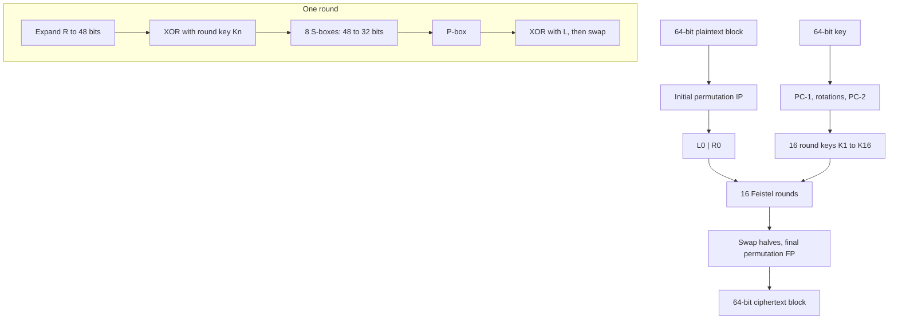

<div align="center">

# DES + CBC, from scratch

**A bit-level implementation of DES and CBC mode in a single Python notebook, verified against the standard test vector.**

[](https://github.com/Abdelrahmanshaheen1/DES-CBC-Notebook/actions/workflows/test.yml)
[](https://colab.research.google.com/github/Abdelrahmanshaheen1/DES-CBC-Notebook/blob/main/des_cbc.ipynb)


[](LICENSE)

</div>

## At a glance

| | |
|---|---|
| **What** | DES tables, key schedule, 16-round Feistel network, encrypt and decrypt, and CBC chaining, with no crypto library |
| **Proof it is right** | Key `133457799BBCDFF1` encrypts `0123456789ABCDEF` to `85E813540F0AB405`, the textbook known-answer vector |
| **Second opinion** | Matches [pycryptodome](https://pycryptodome.readthedocs.io/) on 50 random ECB blocks and a CBC message |
| **Try it** | Click the Colab badge, then Runtime, Run all |
| **CI** | The whole notebook runs on every push, so a failing assertion is a red build |

## Contents

[How DES works here](#how-des-works-here) · [What's implemented](#whats-implemented) · [Key schedule, decryption, tests](#extension-real-key-schedule-decryption-tests) · [Run it](#run-it) · [Limitations](#limitations)

## How DES works here



In CBC mode each plaintext block is XORed with the previous ciphertext block (the IV for the first one) before it goes through DES, so identical plaintext blocks no longer produce identical ciphertext.

## What's implemented

- **Core DES tables:** Initial Permutation (IP), Final Permutation (FP), Expansion (E), all 8 S-boxes, and the P-box permutation — encoded directly as the standard DES bit-position tables.
- **Feistel structure:** 16 rounds of expansion → XOR with the round key → S-box substitution → P-box permutation → swap, exactly matching DES's design.
- **CBC chaining:** plaintext is split into 64-bit blocks (zero-padded if needed), and each block is XORed with the previous ciphertext block (or the IV, for the first block) before DES encryption — the standard CBC construction that prevents identical plaintext blocks from producing identical ciphertext.

## Extension: real key schedule, decryption, tests

The original notebook cells use a fixed, repeated 48-bit placeholder as the round key. The extension cells at the end of the notebook add DES's real key schedule on top, so one 64-bit key now produces 16 different round keys:

- **Key schedule:** PC-1 (drops the 8 parity bits), the per-round left rotations (1, 1, 2, 2, 2, 2, 2, 2, 1, 2, 2, 2, 2, 2, 2, 1) and PC-2.
- **Decryption:** the same Feistel network with the round keys in reverse order, plus CBC decryption.
- **Tests (the last notebook cell):**
  - the round keys K1 and K16 match the textbook worked example;
  - key `133457799BBCDFF1` encrypts `0123456789ABCDEF` to `85E813540F0AB405`, the standard DES known-answer vector;
  - encrypt-then-decrypt returns the original block, and a multi-block CBC message round-trips;
  - output matches [pycryptodome](https://pycryptodome.readthedocs.io/) on 50 random ECB blocks and one CBC message (skipped if the library is not installed).

A GitHub Actions workflow executes the whole notebook on every push, so a failing assertion shows up as a red build. The two original functions gained an optional `verbose=True` flag so the tests can run without printing every round; their default behaviour is unchanged.

## Run it

```bash
pip install jupyter pycryptodome          # pycryptodome is optional, it only enables the cross-check
jupyter nbconvert --to notebook --execute des_cbc.ipynb --output /tmp/executed.ipynb
```

Or open `des_cbc.ipynb` in Jupyter or Colab and run all cells. The last cell holds the tests.

## Limitations

This is a learning implementation, not something to protect real data with:

- Single DES has a 56-bit key and can be brute-forced.
- The demo uses an all-zero IV. CBC needs a fresh random IV for every message.
- Zero padding is not reversible in general (decryption strips NUL characters, which is only safe for plain text). Real systems use PKCS#7.
- The code works on strings of `'0'`/`'1'` characters, which keeps every step visible but is slow and not constant-time.

## Repository layout

```text
.
├── des_cbc.ipynb                # the whole implementation, plus the tests in the last cell
├── .github/workflows/test.yml   # executes the notebook on every push
└── LICENSE
```

## License

[MIT](LICENSE) © 2026 Abdelrahman Shaheen
